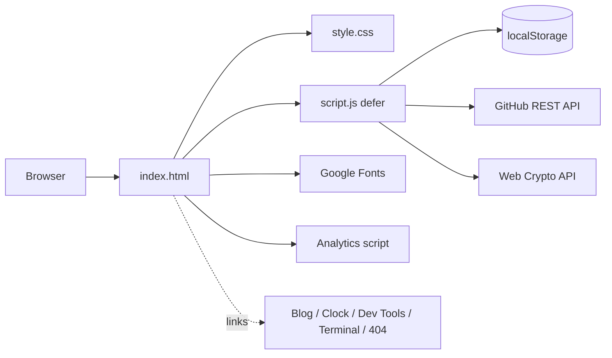

# Architecture — Shubhomoy (Sgdev) Portfolio

A zero-dependency static site built with plain HTML, CSS and JavaScript. No framework, no bundler, no build step. Three files do all the work, and the site can be deployed to any static host (Vercel, GitHub Pages, Cloudflare Pages, and so on).

- **Live domains:** `sgdev.qd.je` and `sgdev.is-cool.dev`
- **Design idea:** black background plus three accent colours that stand for the three web languages: JS yellow `#ffe21a`, HTML red `#cd0d0d`, CSS blue `#1b66d2`.

---

## 1. File structure

```
/
├── index.html      Markup, SEO metadata, JSON-LD, early theme bootstrap
├── style.css       Design tokens, layout, components, animations, responsive rules
├── script.js       All behaviour, one IIFE, no libraries
├── s.png           Avatar, apple-touch-icon, og:image
├── m.ico           Favicon
├── 404/            Separate 404 page (also hosts walrus.webp, the mascot image)
└── blog/           Separate research blog (linked, not part of this bundle)
```

Linked tools hosted elsewhere: `/clock/`, `/devtools/`, `/terminal/` on `www.sgdev.qd.je` and `www.sgdev.is-cool.dev`.

---

## 2. High-level overview



The page is fully usable without any network call apart from the HTML, CSS and JS. Fonts, analytics and GitHub stats are enhancements that fail silently.

---

## 3. Page structure (`index.html`)

| Order | Element | Purpose |
|---|---|---|
| 0 | `<head>` | Meta tags, Open Graph, canonical, JSON-LD `Person` schema, theme bootstrap script |
| 1 | `.machine` | Fixed full-page SVG layer for the gear background (filled by JS) |
| 2 | `.progress` | 3 px scroll progress bar |
| 3 | `header.nav-wrap` | Pill navigation, burger menu on mobile |
| 4 | `section.hero` | Headline, typed roles, call-to-action buttons, status card with fidget spinner |
| 5 | `.strip` | Rotated, auto-scrolling tech marquee |
| 6 | `#about` | Avatar, bio, four skill tiles |
| 7 | `#stack` | HTML / CSS / JS cards with "repaint the site" buttons |
| 8 | `#projects` | Project cards plus the live GitHub card |
| 9 | `#tools` | Tabbed tools: Calculator, SHA-256, Password generator |
| 10 | `#arcade` | Tabbed games: Tic-Tac-Toe, Memory, Reaction, Snake, Typing |
| 11 | `#contact` | Email links, copy button, social links |
| 12 | `footer` | Copyright and both domains |
| 13 | Floating UI | `.mascot`, `.mascot-spot`, `.dock` (accent dots plus back to top), `.toast` |

### Head bootstrap (critical, runs before CSS paints)

A tiny inline script reads `sg-accent` from `localStorage` and sets the `--y`, `--yr` and `--on` CSS variables immediately. This prevents a yellow flash for visitors who picked red or blue.

### Accessibility notes

- Tabs use `role=tablist / tab / tabpanel` with arrow-key navigation and roving `tabindex`.
- Live regions (`aria-live`) are used for toasts and game status.
- The calculator and Snake board are focusable and keyboard-driven.
- `prefers-reduced-motion` disables animations, and the typed text, gears and count-up numbers are skipped or frozen.
- Decorative elements (gears, strip, machine layer) use `aria-hidden="true"`.

---

## 4. Styling (`style.css`)

### Design tokens (`:root`)

| Variable | Meaning |
|---|---|
| `--y` | Current accent colour (changed by the theme picker) |
| `--yr` | Same accent as `r,g,b`, used for `rgba(var(--yr), .x)` glows |
| `--on` | Text colour that sits on top of the accent (`#000` on yellow, `#fff` on red and blue) |
| `--y-dim` | Accent at 14% opacity for gradients |
| `--bg`, `--panel`, `--line` | Black, near-black panel, border grey |
| `--text`, `--muted` | Main and secondary text colours |
| `--display`, `--body` | Bricolage Grotesque (headings) and Inter (body) |

Because every accent-coloured surface reads `var(--y)`, one change in JS recolours the entire site, including the gear machine and the Snake game.

### Component groups

- **Layout:** `.wrap` (max 1080 px), `.hero`, `.about`, `.grid`, `.lgrid`, `.gwrap`
- **Navigation:** `.nav`, `.nb`, `.burger`, `.progress`
- **Cards:** `.card` (+ `.wide`, `.gh`), `.pv1`–`.pv6` preview panels, `.pill` status badges
- **Tools and games:** `.tool`, `.tabs`, `.panel`, `.calc`, `.ttt`, `.mem`, `.rarea`, `#sc`, `.tprompt`
- **Floating UI:** `.dock`, `.toast`, `.mascot`, `.mascot-spot`
- **Background:** `.machine` (z-index −1, fixed, pointer-events none)

### Animation inventory

| Animation | Where |
|---|---|
| `ping`, `blink` | "Open to collaborations" dot, status pill dots, typing caret |
| `slide` | Tech strip |
| `spin` | Clock-card gears |
| `scan` | Dev Tools card progress bar |
| `rain` | Matrix Terminal card code rain |
| `dance` | Walrus mascot |
| Scroll reveal | `.rv` to `.rv.in` fade and rise |

### Responsive breakpoints

- `≤ 860px`: single-column layouts, burger menu, smaller spinner, stacked wide cards
- `≤ 600px`: smaller mascot and mascot hit area
- `≤ 480px`: accent dots hidden in the dock
- `(pointer: coarse)`: on-screen D-pad for Snake

---

## 5. Behaviour (`script.js`)

Everything lives in one strict-mode IIFE. Helpers: `$()` (getElementById), `store()` (safe `localStorage`), `toast()`, `copy()`, and `idle()` (a `requestIdleCallback` polyfill).

### Module map

| Section | Responsibility |
|---|---|
| Toast + clipboard | Global toast. Delegated click handler for `[data-copy]` and `[data-copy-from]` |
| 1. Mobile menu | Burger toggle, closes on link click or Escape |
| 2. Active nav + progress | One rAF-throttled scroll handler: active nav link, progress bar, back-to-top visibility |
| 3. Scroll reveal | `IntersectionObserver` adds `.in` to cards, tiles and tools |
| 3b. Mascot | Dances, speeds up on click, hides after 12 s, corner click brings it back |
| 4. Fidget spinner | Pointer-event physics: drag, fling, friction decay, RPM readout, best score |
| 5. Calculator | Safe recursive-descent parser (**no `eval`**), keyboard support, history of the last 6 results |
| 6. Tabs, SHA-256, Password | Accessible tab widget, Web Crypto hashing, rejection-sampled password generator with entropy estimate |
| 6b. Arcade | Tic-Tac-Toe (minimax), Memory, Reaction, Snake (canvas), Typing test |
| 6c. Gear machine | Procedural meshing gears drawn as SVG paths, driven by time plus scroll |
| 7. Idle work | Typed roles, theme picker, lazy GitHub stats |

### Gear machine maths

- Module `M = 6`. A gear with `n` teeth has pitch radius `n·M/2`.
- Child gears are placed at distance `M·(n₁+n₂)/2` from their parent at a chosen angle, so teeth touch exactly.
- The starting rotation of each child is computed from the parent's phase so teeth fall into gaps.
- Angular speed ratio is `−parent.w · parent.n / child.n`, so neighbours turn in opposite directions at the correct ratio.
- Rotation is `time · 0.012 + scrollDelta · 0.25`, so scrolling speeds the machine up.
- Every fourth gear gets the `.hot` class for a brighter outline.

### Mascot lifecycle

```
load ──12s──▶ hide (.away, spot visible)
click spot ──▶ show (spot hidden) ──12s──▶ hide ...
click mascot ──▶ "hype" dance 2.5s + timer resets
```

### Idle-time work

Non-critical features start inside `idle()` so they never delay first paint:

1. Typed role animation (skipped under reduced motion)
2. Theme picker (three dots in the dock plus `[data-theme]` buttons in the stack section)
3. GitHub stats loader, which only fires when the card is within 300 px of the viewport

### GitHub stats flow

```
card near viewport ─▶ cache fresh (<1h)? ─yes─▶ paint from localStorage
                                          └no─▶ fetch /users/sgdev-official
                                                + /repos?sort=pushed&per_page=4
                                                ─▶ filter forks, keep 4 ─▶ cache + paint
                                                └ on failure: show a friendly note
```

---

## 6. Client storage

All keys are prefixed `sg-` and written through the safe `store()` wrapper, which swallows errors when storage is blocked.

| Key | Content |
|---|---|
| `sg-accent` | Selected accent hex (`#ffe21a`, `#cd0d0d` or `#1b66d2`) |
| `sg-spin-best` | Highest spinner RPM |
| `sg-mem` | Best (lowest) Memory move count |
| `sg-react` | Best reaction time in ms |
| `sg-snake` | Snake high score |
| `sg-wpm` | Best typing WPM (needs ≥ 90% accuracy) |
| `sg-gh` | `{t, d}`: timestamp and cached GitHub stats |

No cookies. No user text is sent anywhere: calculator, hashing and password generation run entirely in the browser.

---

## 7. External dependencies

| Resource | Used for | Failure impact |
|---|---|---|
| Google Fonts (Bricolage Grotesque, Inter) | Typography | Falls back to system fonts |
| `analytics.open-domains.com/script.js` | Privacy-friendly analytics (deferred) | None |
| `api.github.com` | Live repo and follower numbers | Shows a note, link still works |
| Web Crypto (`crypto.subtle`, `getRandomValues`) | SHA-256, passwords | SHA-256 needs HTTPS and shows a message otherwise |

---

## 8. Performance and security notes

- `script.js` is `defer`red. Fonts use `preconnect`.
- Scroll work is throttled with `requestAnimationFrame` and passive listeners.
- Animated numbers, typing and GitHub fetching wait for idle time or visibility.
- Calculator uses a hand-written parser, never `eval`.
- Passwords use `crypto.getRandomValues` with rejection sampling to avoid modulo bias, and ambiguous characters (`l`, `1`, `I`, `0`, `O`) are excluded.
- Dynamic DOM content is built with `textContent` and `createElement`, not `innerHTML`, so GitHub data cannot inject markup.
- External links use `rel="noopener"`.
- The machine layer is `pointer-events: none` and sits behind all content.

---

## 9. How to extend

| Task | Where |
|---|---|
| Add a project card | Duplicate a `<a class="card">` in `#projects`, add a `.pvN` preview style in CSS |
| Add a nav link | Add an `<a class="nb" data-s="id">` and push the section id into `ids` in `script.js` |
| Add a game or tool | Add a tab button and `.panel` in the matching `.tool`, then an IIFE in section 6/6b |
| Add a status row | Add an `<a class="srow">` in `.status-card` with a `.pill` (`on`, `dev` or `maint`) |
| Add gears | Append `{n, p, a}` to the `G` array in section 6c (parent index and angle in degrees) |
| Change mascot timing | Edit `SHOW_MS` in section 3b |
| Add an accent colour | Add to `colors` in section 7 and to the regex in the head bootstrap |
| Change GitHub user | Edit `U` in the GitHub stats block |

### Conventions

- Keep one accent variable (`--y`) as the single source of colour.
- Use `.rv` (via the `items` selector in script) for anything that should fade in on scroll.
- Keep new features inside their own IIFE and guard with `if (!el) return;` so missing markup never breaks the rest.
- No new dependencies: if a feature needs a library, write it small and inline.

---

## 10. Known limits

- Gear positions are tuned for a 1200 × 800 viewBox with `xMidYMid slice`, so very narrow or very wide screens crop some gears.
- Under reduced motion the gear machine renders once and does not follow scroll.
- Best scores and theme live only in the visitor's browser, with no cross-device sync.
